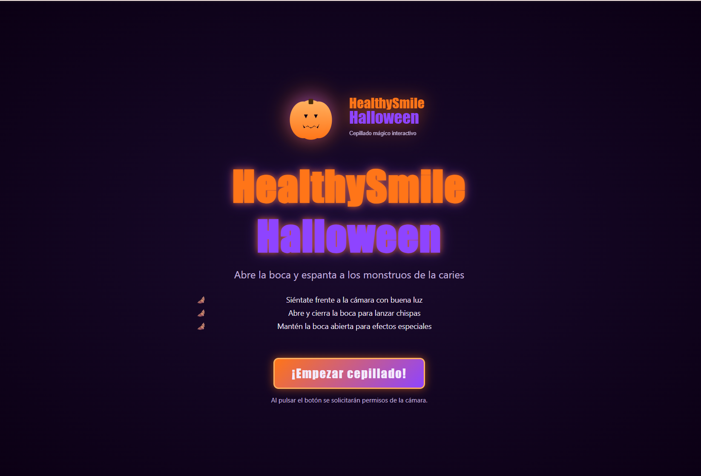

# 🎃 HealthySmile Halloween · Cepillado Mágico

Aplicación interactiva de escritorio para que los niños aprendan a abrir
bien la boca durante el cepillado dental, con **temática Halloween**.
Detecta la cara y la apertura de la boca con la webcam y responde con
partículas animadas.

Actividad **R2** · UOC · 20.671 Desarrollo de Aplicaciones Interactivas
Autor: **Arturo Navarrete Jiménez** · Octubre 2026



## 🪄 ¿Qué hace?

Cuando el niño abre la boca frente a la cámara, un cepillo mágico lanza
chispas de Halloween. Hay tres niveles:

- **Boca abierta < 1 s** → chispas naranjas (calabaza)
- **Boca abierta entre 1 y 4 s** → + murciélagos moradosmurcélagos
- **Boca abierta > 4 s** → + anillo de calabazas que gira

Hay que acumular **15 segundos** con la boca abierta para completar el
cepillado.

## 🛠 Tecnologías

- **p5.js 2.2.3** para el canvas, la cámara y las animaciones.
- **MediaPipe Face Landmarker** para los 478 puntos faciales.
- **Tauri v2** para el empaquetado como app de escritorio.
- **CSS externo** para la UI del DOM.

El razonamiento de por qué MediaPipe y no ml5 está en
[`docs/investigacion-librerias.md`](docs/investigacion-librerias.md).

## 📂 Estructura

```
proyecto/
├── src/
│   ├── index.html           # DOM + 4 pantallas (loading, bienvenida, juego, final)
│   ├── style.css            # Hoja de estilos externa (requisito R2)
│   ├── sketch.js            # Entrada p5 instancia + estados
│   ├── faceDetection.js     # MediaPipe + cálculo de apertura
│   ├── particles.js         # Sistema de partículas (3 niveles)
│   └── assets/
│       ├── images/logo.svg  # Logo original (recurso multimedia)
│       └── sounds/spark.wav # Sonido original (generado por código)
├── src-tauri/               # Configuración de Tauri v2
├── docs/                    # Documentación para Folio y licencias
├── esbozos/                 # Bocetos a mano (añadir .jpg)
├── package.json
├── README.md
└── LICENSE
```

## 🚀 Ejecución

### Opción A · Solo en navegador (editor online de p5)

Para la entrega en Folio es obligatorio enlazar al editor online. Pasos:

1. Abre https://editor.p5js.org/ y crea un nuevo sketch.
2. Copia el contenido de `src/sketch.js`, `src/faceDetection.js` y
   `src/particles.js` como ficheros `.js` separados.
3. Copia `src/index.html` sobre el `index.html` del editor.
4. Copia `src/style.css` sobre el `style.css` del editor.
5. Sube `src/assets/images/logo.svg` y `src/assets/sounds/spark.wav` a la
   carpeta de ficheros del editor.
6. Pulsa Play. Si usa Chrome y falla, prueba con **Firefox** (lo avisa el
   enunciado).

### Opción B · Prueba local rápida (navegador, sin Tauri)

```bash
cd proyecto
npm run dev
```
Abre http://localhost:5173.

### Opción C · Aplicación de escritorio con Tauri (recomendada)

**Requisitos previos en Windows:**

1. **Node.js 20+** (ya lo tienes probablemente) — https://nodejs.org
2. **Rust estable** — https://www.rust-lang.org/tools/install (ejecuta
   `rustup-init.exe` y acepta las opciones por defecto).
3. **Microsoft C++ Build Tools** — vienen con Visual Studio Community o se
   instalan sueltas. En el instalador marca el workload
   *"Desarrollo para escritorio con C++"*.
4. **WebView2 Runtime** — ya viene en Windows 10 y 11.

**Instalar y arrancar:**

```bash
cd proyecto
npm install
npm run tauri:dev
```

La primera compilación tarda varios minutos (compila Rust). Las siguientes
son rápidas. La ventana se abre en **pantalla completa a 1920×1080**, sin
bordes, cumpliendo el requisito de "modo kiosko".

**Para generar un ejecutable:**

```bash
npm run tauri:build
```

Se crea un `.exe` en `src-tauri/target/release/`. El enunciado dice que no
es obligatorio entregar instalador.

## ⚠️ Problemas conocidos

- **Permiso de cámara denegado en WebView2.** Si al arrancar la app por
  primera vez pulsas "Bloquear", WebView2 recuerda la decisión y no
  volverá a preguntar
  ([tauri#5042](https://github.com/tauri-apps/tauri/issues/5042)). Para
  resetearlo: cierra la app, borra la carpeta
  `%LOCALAPPDATA%\com.arturo.healthysmile.halloween\EBWebView\Default` y
  vuelve a lanzarla.
- **Necesita internet en el primer arranque** para descargar la librería
  de MediaPipe y el modelo. Después, WebView2 los cachea.
- **Chrome y ml5.js:** no afecta aquí porque uso MediaPipe directamente.
- Para salir del modo pantalla completa: pulsa `F` o `Alt+F4`.

## 📜 Licencia

MIT. Ver `LICENSE`. Las librerías externas se cargan en runtime desde CDN,
cada una con su propia licencia (ver `docs/licencias.md`).
